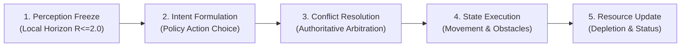

# WorldSim

[](https://www.python.org/)
[](file:///d:/SimWorld/tests)
[](file:///d:/SimWorld/worldsim)
[](file:///d:/SimWorld/run_viewer.py)
[](LICENSE)

**WorldSim** is an open-source, deterministic multi-agent simulation and decentralized reinforcement learning research platform. It investigates how autonomous agents coordinate, navigate tight bottlenecks, budget constrained energy, and avoid dynamic hazards under **strict partial observability ($R \le 2.0$)** with short-range communicative intent.

Built with **zero third-party runtime dependencies** using the Python Standard Library, WorldSim features a real-time, interactive 2D web viewer (HTML5 Canvas) and a comprehensive benchmark suite evaluated across multi-seed generalization topologies.

---

## Table of Contents

- [Overview & Key Features](#overview--key-features)
- [Live 2D Interactive Web Viewer](#live-2d-interactive-web-viewer)
- [Empirical Multi-Seed Generalization Benchmark](#empirical-multi-seed-generalization-benchmark)
- [System Architecture & Physics Engine](#system-architecture--physics-engine)
- [Coordination Policies](#coordination-policies)
- [Repository Organization](#repository-organization)
- [Quickstart & CLI Usage](#quickstart--cli-usage)
- [Cloud Hosting & Deployment](#cloud-hosting--deployment)
- [Research History & Documentation](#research-history--documentation)

---

## Overview & Key Features

* **Bit-for-Bit Determinism:** Movement resolution, collision handling, dynamic obstacle trajectories, and resource allocation are fully deterministic and reproducible across seeds.
* **Strict Partial Observability:** Agents make decisions using local observations within a localized Euclidean radius ($R \le 2.0$). Global maps and distant agent plans are invisible.
* **Decentralized Learning & Communicative Intent:** Peer agents exchange short-range intention vectors within sensory range ($R \le 2.0$) to negotiate bottlenecks and prevent collision deadlocks.
* **Dynamic Moving Hazards:** Moving obstacles with velocity vectors and predictive bounce dynamics navigate the grid; agents anticipate trajectories and replan dynamically.
* **Energy Economics & Recharging:** Agents must manage finite battery budgets, evaluate recharge station utilities, and navigate without suffering terminal exhaustion.
* **Zero Runtime Dependencies:** The simulation engine, reinforcement learning agents, and web viewer run on vanilla Python (`http.server`, `math`, `heapq`, `dataclasses`, `json`).

---

## Live 2D Interactive Web Viewer

WorldSim includes an integrated, zero-dependency browser interface driven by an authoritative Python simulation session:

```
+-------------------------------------------------------------------------------+
|  WorldSim Live 2D Viewer | Scenario: [ D01 v ] | Policy: [ hybrid_comm v ]   |
+------------------------------------------------------+------------------------+
|                                                      | Agent Inspector        |
|   (0,0)                                              | ---------------------- |
|     +---+---+---+---+---+---+                        | ID: agent_1            |
|     | . | . | R | . | . | . |                        | Status: active         |
|     +---+---+---+---+---+---+                        | Pos: (3, 4)            |
|     | . |(A1)-->| . |[#]| . |  [#] Dynamic Hazard    | Energy: 7 / 10 [|||||] |
|     +---+---+---+---+---+---+                        | Intent: (3, 5) [DOWN]  |
|     | . | . | : | . | . | . |  (A1) Active Agent     | Visible Peers: agent_2 |
|     +---+---+---+---+---+---+                        | ---------------------- |
|     | . | . |(A2)<--| . | G |  (R)  Recharge Station | Telemetry              |
|     +---+---+---+---+---+---+                        | Step: 14  | Tick: 14   |
|                                (G)  Target Goal      | Collisions: 0          |
|   [< Play/Pause] [>| Step] [R Reset] Speed: [===|==] | Deadlocks: 0           |
+------------------------------------------------------+------------------------+
```

### Viewer Highlights
* **Authoritative Simulation Loop:** The browser never simulates physics; it queries Python REST endpoints (`/api/state`, `/api/step`, `/api/reset`, `/api/select`).
* **Interactive Agent Inspector:** Click any agent token on the grid to inspect its real-time energy, intent target, visible peers, and active memory.
* **Toggleable Debug Overlays:** Sensory horizon circles ($R \le 2.0$), peer-to-peer intent rays, dynamic hazard velocity vectors, breadcrumb trails, and conflict markers.

### Launching the Web Viewer
```bash
# Start viewer locally (opens http://localhost:8000 automatically)
python run_viewer.py

# Launch with custom scenario, policy, and port:
python run_viewer.py --scenario U14 --policy hybrid_comm --port 8080
```

#### Keyboard Shortcuts
| Key | Action | Key | Action |
| :---: | :--- | :---: | :--- |
| <kbd>Space</kbd> | Toggle Play / Pause | <kbd>H</kbd> | Toggle Sensory Horizon ($R \le 2.0$) |
| <kbd>N</kbd> / <kbd>→</kbd> | Single Step Forward | <kbd>I</kbd> | Toggle Intent Vectors |
| <kbd>R</kbd> | Reset Scenario | <kbd>O</kbd> | Toggle Dynamic Hazard Paths |
| <kbd>T</kbd> | Toggle Breadcrumb Trails | <kbd>C</kbd> | Toggle Conflict / Deadlock Markers |

---

## Empirical Multi-Seed Generalization Benchmark

To evaluate policy robustness and generalization, models were benchmarked across **6 diverse challenge environments** using **20 independent random seeds per scenario** (120 evaluation episodes per policy).

Full results and methodology are documented in [`reports/GENERALIZATION_STRESS_REPORT.md`](file:///d:/SimWorld/reports/GENERALIZATION_STRESS_REPORT.md) and [`benchmarks/multi_seed_generalization_results.json`](file:///d:/SimWorld/benchmarks/multi_seed_generalization_results.json).

### Comparative Performance Matrix (20 Seeds per Scenario)

| Scenario | Environment Topology & Challenge | `centralized` (Omniscient) | `hybrid_comm` (Learned + Safety) | `heuristic` (Robust BFS) | `learned_comm` (Decentralized + Intent) | `learned_no_comm` (No Comm Baseline) |
| :--- | :--- | :---: | :---: | :---: | :---: | :---: |
| **D01** | Dual Patrol Crossing (Moving Hazards) | **100%** (14.0s) | **100%** (11.0s) | **100%** (14.0s) | **100%** (11.0s) | **0%** *(92 cols)* |
| **D03** | Dynamic Corridor Mesh (4 Moving Hazards) | **100%** (13.0s) | **100%** (18.0s) | **100%** (13.0s) | **100%** (18.0s) | **0%** *(188 cols)* |
| **U01** | Asymmetric Diagonal Crossing | 0% *(Deadlock)* | **100%** (11.0s) | 0% *(Deadlock)* | **100%** (11.0s) | 0% *(Deadlock)* |
| **U04** | Multi-Resource Separated Maze | **100%** (2.0s) | **100%** (2.0s) | **100%** (2.0s) | **100%** (2.0s) | 0% *(100 cols)* |
| **U06** | Severe 8-Agent Asymmetric Bottleneck | **100%** (19.0s) | 0% *(87.5% ind)* | **100%** (19.0s) | 0% *(Exhaustion)* | 0% *(Exhaustion)* |
| **U14** | Narrow Corridor Swap (Reusable Station) | 0% *(Deadlock)* | 0% *(50% ind)* | 0% *(Deadlock)* | 0% *(50% ind)* | 0% *(Deadlock)* |

### Scientific Insights & Failure Mode Analysis
1. **The Decisive Value of Communicative Intent:** In dynamic hazard scenarios (`D01`, `D03`), sharing short-range intent ($R \le 2.0$) elevated completion from **0% to 100%**, eliminating repeated vertex collisions.
2. **Where Reactive Learning Outperforms Heuristic Search:** In asymmetric crossing topologies (`U01`), both rule-based heuristic and centralized coordinators deadlocked in symmetric swaps. `learned_comm` resolved the deadlock dynamically in 11.0 steps.
3. **Where Planning Excels Over Reactive Models:** In dense 8-agent bottlenecks (`U06`), long-horizon energy management requires multi-step lookahead; heuristic graph search achieved 100% completion while pure reactive learning suffered premature energy exhaustion.

---

## System Architecture & Physics Engine

### Simultaneous 5-Phase Tick Model

Every simulation tick executes an atomic 5-phase lifecycle:


### Deterministic Collision Rules
* **Vertex Collisions:** When two or more agents target the same cell in the same tick, moving claimants bounce back to their origins, or rotate right-of-way via tick-based priority.
* **Swap Collisions:** When two agents attempt to swap positions across an edge, both bounce back to prevent clipping.
* **Occupied Collisions:** Attempting to enter a cell occupied by a stationary or paused agent is blocked cost-free without energy penalty.
* **Goal-Cell Yielding:** Agents that reach their destination (`reached_target`) remain at their goal but yield right-of-way, allowing trailing active agents to traverse corridor bottlenecks.

---

## Coordination Policies

| Policy | Description | Information Boundary | Strengths |
| :--- | :--- | :---: | :--- |
| **`hybrid_comm`** *(Default)* | Learned Q-policy with safe recharge/detour arbitration and local intent communication | Local Horizon ($R \le 2.0$) | High safety, zero collisions, balances learned speed with safety guards. |
| **`learned_comm`** | Pure decentralized Q-learner using local peer intent vectors | Local Horizon ($R \le 2.0$) | Fast learned execution; excels at dynamic obstacle evasion and corridor swaps. |
| **`learned_no_comm`** | Non-communicative decentralized Q-learner | Local Sensory Only | Experimental control baseline measuring the empirical value of communication. |
| **`heuristic`** | Rule-based `RobustResourcePolicy` with BFS corridor routing and obstacle memory TTL | Local Sensory Only | Deterministic graph search; excels at complex multi-step energy routing. |
| **`centralized`** | Omniscient centralized multi-agent coordinator with global reservation table | Global Privileged | Upper-bound reference baseline. |

---

## Repository Organization

The repository is structured into modular packages, isolating experiments, benchmarks, and historical documentation from the core runtime engine:

```
SimWorld/
├── worldsim/                 # Core Python simulation engine (Zero External Dependencies)
│   ├── actions.py            # Movement and recharge action definitions
│   ├── config.py             # World and simulation configurations
│   ├── coordination.py       # Multi-agent arbitration, deadlock detection & priority rules
│   ├── decentralized_learning.py # Q-learning models, feature extractors & hybrid policy
│   ├── dynamic_obstacles.py  # Moving hazard physics & trajectory prediction
│   ├── energy.py             # Energy management & recharge validation
│   ├── models.py             # Immutable Position, Resource, and Observation models
│   ├── multi_agent.py        # Simultaneous 5-phase simulation engine
│   ├── robust_policy.py      # BFS path planning, obstacle memory TTL & cycle breaker
│   ├── web_viewer.py         # Authoritative REST API & LiveViewerServer
│   └── static/
│       └── index.html        # High-DPI HTML5 Canvas live visualization SPA
│
├── experiments/              # Evaluation harnesses & benchmark runners
│   ├── eval_generalization.py# Multi-seed empirical generalization benchmark
│   ├── phase13_5_unseen_audit.py
│   ├── phase14_2_local_horizon_eval.py
│   ├── phase14_3_dynamic_obstacle_eval.py
│   └── phase14_4_learned_coordination_eval.py
│
├── benchmarks/               # Machine-readable JSON evaluation datasets & model weights
│   ├── multi_seed_generalization_results.json
│   ├── phase14_4_weights_comm.json
│   └── ...
│
├── reports/                  # Markdown audit and verification reports
│   ├── GENERALIZATION_STRESS_REPORT.md
│   ├── PHASE15_VERIFICATION_REPORT.md
│   └── ...
│
├── tests/                    # Comprehensive automated test suite (252 unit & integration tests)
├── docs/                     # Documentation archive & historical research audits
│   └── RESEARCH_HISTORY.md   # Chronological research logs (Phases 1 through 15)
│
├── run_viewer.py             # CLI launcher for the Live 2D Web Viewer
├── Dockerfile                # Production container deployment configuration
├── Procfile                  # Cloud web service process declaration (Render / Railway)
└── README.md
```

---

## Quickstart & CLI Usage

### Prerequisites
* **Python 3.10+** (Python 3.10, 3.11, 3.12, 3.13 tested).
* No external libraries required to run the simulation or live viewer.

### 1. Launch the Live 2D Web Viewer
```bash
python run_viewer.py
```
Open **[http://localhost:8000](http://localhost:8000)** in your browser.

### 2. Run the Full Test Suite
Execute all 252 automated unit and integration tests:
```bash
python -m pytest
```
*Expected output: `252 passed in ~10s`.*

### 3. Run the Multi-Seed Generalization Benchmark
Reproduce the multi-seed empirical comparison across 6 scenarios, 5 policies, and 20 seeds:
```bash
python -m experiments.eval_generalization
```

---

## Cloud Hosting & Deployment

WorldSim's viewer is a stateful simulation and can be deployed with one click to persistent web hosts:

### Deploying to Render.com (Recommended Free Hosting)
1. Fork or push this repository to GitHub.
2. Sign in to [Render.com](https://render.com) and click **New +** → **Web Service**.
3. Select your repository (`WorldSim`).
4. Render detects the included [`Procfile`](file:///d:/SimWorld/Procfile) and [`Dockerfile`](file:///d:/SimWorld/Dockerfile) automatically.
5. Set **Start Command** (if manual):
   ```bash
   python run_viewer.py --host 0.0.0.0 --port $PORT --no-browser
   ```
6. Click **Create Web Service**. Render provides a free public HTTPS domain.

### Deploying via Docker
```bash
# Build Docker image
docker build -t worldsim .

# Run container mapping port 8000
docker run -p 8000:8000 worldsim
```

---

## Research History & Documentation

For detailed mathematical proofs, diagnostic logs, and phase-by-phase development audits from Phase 1.0 to Phase 15.0, refer to the documentation archive:
* [`docs/RESEARCH_HISTORY.md`](file:///d:/SimWorld/docs/RESEARCH_HISTORY.md): Detailed phase-by-phase scientific audit archive.
* [`reports/GENERALIZATION_STRESS_REPORT.md`](file:///d:/SimWorld/reports/GENERALIZATION_STRESS_REPORT.md): Multi-seed statistical benchmark report.
* [`reports/PHASE15_VERIFICATION_REPORT.md`](file:///d:/SimWorld/reports/PHASE15_VERIFICATION_REPORT.md): End-to-end verification and headless browser audit.

---

## License

This project is licensed under the MIT License. See [LICENSE](LICENSE) for details.
