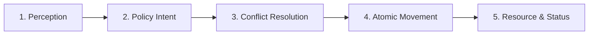

# WorldSim

[](https://www.python.org/)
[](file:///d:/SimWorld/tests)
[](file:///d:/SimWorld/worldsim)
[](file:///d:/SimWorld/run_viewer.py)
[](LICENSE)

**WorldSim** is a lightweight, strictly deterministic multi-agent simulation and decentralized reinforcement learning environment. Designed for AI research in multi-agent coordination, energy-constrained pathfinding, dynamic obstacle avoidance, and communicative intent under strict partial observability.

The runtime engine requires **zero third-party dependencies** (implemented entirely with the Python Standard Library) and includes a high-performance **interactive 2D live web viewer** built with HTML5 Canvas.

---

## Table of Contents

- [Key Capabilities](#key-capabilities)
- [Interactive Live 2D Web Viewer](#interactive-live-2d-web-viewer)
- [Core Simulation Engine & Mechanics](#core-simulation-engine--mechanics)
  - [Simultaneous 5-Phase Tick Model](#simultaneous-5-phase-tick-model)
  - [Spatial Conflict & Collision Resolution](#spatial-conflict--collision-resolution)
  - [Energy Economics & Resource Arbitration](#energy-economics--resource-arbitration)
  - [Dynamic Moving Obstacles](#dynamic-moving-obstacles)
- [Coordination Policies](#coordination-policies)
- [Standard Benchmark Suite](#standard-benchmark-suite)
- [Quickstart Guide](#quickstart-guide)
  - [Prerequisites](#prerequisites)
  - [Launching the 2D Web Viewer](#launching-the-2d-web-viewer)
  - [Running Evaluation Benchmarks](#running-evaluation-benchmarks)
  - [Running the Test Suite](#running-the-test-suite)
- [Cloud Hosting & Deployment](#cloud-hosting--deployment)
- [Codebase Architecture](#codebase-architecture)
- [Scientific Milestones & Research History](#scientific-milestones--research-history)

---

## Key Capabilities

* **Authoritative Determinism:** Every step, movement resolution, collision event, and resource competition is bit-for-bit deterministic and seeded.
* **Strict Partial Observability:** Agents perceive the grid within a localized Euclidean sensory horizon ($R \le 2.0$). No agent has access to global coordinates, omniscient maps, or distant agent plans.
* **Energy-Constrained Navigation:** Entities must budget energy, evaluate recharge utilities for consumable and reusable stations, and navigate without suffering terminal starvation.
* **Dynamic Obstacle Avoidance:** Moving hazards with linear and bouncing velocities navigate the grid; agents predict obstacle trajectories and dynamically re-plan.
* **Decentralized Learning & Communicative Intent:** Peer agents exchange short-range intention vectors ($R \le 2.0$) to negotiate bottlenecks, doorsteps, and narrow corridor swaps without centralized control.
* **Zero Runtime Dependencies:** The entire simulation, learning policies, and web server run purely on standard Python (`http.server`, `math`, `heapq`, `dataclasses`, `json`).
* **Rich 2D Web Viewer:** Real-time browser-based visualization with sub-second position interpolation, interactive inspector, conflict telemetry, and sensory overlays.

---

## Interactive Live 2D Web Viewer

WorldSim includes an integrated, zero-dependency browser interface (Phase 15.0) that renders the simulation state in real time:

```
+-------------------------------------------------------------------------------+
|  WorldSim Live 2D Viewer | Scenario: [ D01 v ] | Policy: [ hybrid_comm v ]   |
+------------------------------------------------------+------------------------+
|                                                      | Agent Inspector        |
|   (0,0)                                              | ---------------------- |
|     +---+---+---+---+---+---+                        | ID: agent_1            |
|     | . | . | R | . | . | . |                        | Status: active         |
|     +---+---+---+---+---+---+                        | Pos: (3, 4)            |
|     | . |(A1)-->| . |[#]| . |  [#] Dynamic Hazard    | Energy: 7 / 10 [|||||] |
|     +---+---+---+---+---+---+                        | Intent: (3, 5) [DOWN]  |
|     | . | . | : | . | . | . |  (A1) Active Agent     | Visible Peers: agent_2 |
|     +---+---+---+---+---+---+                        | ---------------------- |
|     | . | . |(A2)<--| . | G |  (R)  Recharge Pad     | Simulation Telemetry   |
|     +---+---+---+---+---+---+                        | Step: 14  | Tick: 14   |
|                                (G)  Goal / Target    | Collisions: 0          |
|   [< Play/Pause] [>| Step] [R Reset] Speed: [===|==] | Deadlocks: 0           |
+------------------------------------------------------+------------------------+
```

### Viewer Features
* **Authoritative Simulation Loop:** The browser never simulates physics. It queries the Python `SimulationSession` via lightweight REST endpoints (`/api/state`, `/api/step`, `/api/reset`, `/api/select`).
* **Interactive Agent Inspector:** Click any agent token on the grid to inspect its current coordinates, remaining energy, intent target, visible peers, and active memory.
* **Toggleable Visual Overlays:**
  * **Sensory Horizon:** Renders dashed circles showing each agent's localized sensory boundary ($R \le 2.0$).
  * **Communication Links & Intent Vectors:** Visualizes broadcasted peer intents and peer-to-peer rays.
  * **Hazard Vectors:** Displays dynamic obstacle predicted trajectories and velocities.
  * **Breadcrumb Trails:** Tracks historical agent trajectories across ticks.
  * **Conflict & Deadlock Glyphs:** Highlights locations where vertex or swap contentions occurred.

### Launching the Web Viewer
```bash
# Start viewer on default port 8000 with default scenario D01
python run_viewer.py

# Launch with custom scenario, policy, and port:
python run_viewer.py --scenario U14 --policy hybrid_comm --port 8080
```
Open **[http://localhost:8000](http://localhost:8000)** in your browser.

#### Viewer Keyboard Shortcuts
| Key | Action |
| :---: | :--- |
| <kbd>Space</kbd> | Toggle Play / Pause |
| <kbd>N</kbd> or <kbd>→</kbd> | Single Step forward |
| <kbd>R</kbd> | Reset current scenario |
| <kbd>T</kbd> | Toggle breadcrumb trails |
| <kbd>H</kbd> | Toggle sensory horizon overlay |
| <kbd>I</kbd> | Toggle intent vectors |
| <kbd>O</kbd> | Toggle dynamic obstacle vectors |
| <kbd>C</kbd> | Toggle conflict/deadlock markers |

---

## Core Simulation Engine & Mechanics

### Simultaneous 5-Phase Tick Model

Every simulation tick executes an atomic 5-phase lifecycle:


1. **Perception Freeze:** Local observations (`MultiAgentObservation`) are constructed for all agents within Euclidean radius $R \le 2.0$.
2. **Intent Formulation:** Each agent's assigned policy computes an intended action (`UP`, `DOWN`, `LEFT`, `RIGHT`, `RECHARGE`, `STAY`).
3. **Iterative Conflict Resolution:** Authoritative multi-agent movement arbitration resolves collisions without clipping or race conditions.
4. **State Transition Execution:** Permitted movements update agent coordinates, decrement energy costs, and move dynamic obstacles.
5. **Resource Interaction & Lifecycle:** Active recharge stations replenish energy; depleted consumable stations are retired; terminal criteria (`reached_target` or `exhausted`) are recorded.

### Spatial Conflict & Collision Resolution

The engine evaluates actions with four deterministic collision rules:
* **Vertex Collision:** When two or more agents target the same cell in the same tick, moving agents are bounced back to their origin coordinates, or prioritized via tick-based rotation.
* **Swap Collision:** When Agent $A$ attempts to move to $P_B$ and Agent $B$ attempts to move to $P_A$, both agents bounce back to their initial positions to prevent clipping.
* **Occupied Collision:** Moving into a cell occupied by a stationary or paused agent is blocked cost-free.
* **Following / Train Movement:** If Agent $A$ moves into cell $P_B$ while Agent $B$ safely vacates $P_B$ to cell $P_C$, Agent $A$'s move is permitted.
* **Completed Agent Yielding:** Agents that have successfully reached their goal (`reached_target`) remain at their target but yield right-of-way, allowing trailing active agents to traverse corridor bottlenecks.

### Energy Economics & Resource Arbitration

* **Movement Cost:** Every successful step consumes `movement_energy_cost` (default $1$ energy). Blocked or invalid moves consume zero energy.
* **Recharge Action:** Executing `Action.RECHARGE` on a resource station replenishes energy up to `max_energy`.
* **Consumable vs. Reusable Resources:**
  * *Consumable:* Depleted immediately upon the first successful recharge.
  * *Reusable:* Can be used repeatedly by multiple agents over time, but allows only one claimant per tick.
* **Resource Contention Arbitration:** When multiple agents attempt to recharge at the same station simultaneously, the `ResourceArbitrator` resolves access using fairness rules:
  * `fair_balanced`: Combines energy urgency (prioritizing critical energy) with starvation prevention (prioritizing agents with repeated contested rejections).
  * `priority_rotation`: Deterministic round-robin rotation across ticks.
  * `lowest_id`: Alphabetical tie-breaking baseline.

### Dynamic Moving Obstacles

Phase 14.3 introduced moving hazards that navigate the grid alongside agents:
* **Deterministic Motion:** Moving obstacles follow configured waypoints, patrol paths, or velocity vectors (`vx`, `vy`), bouncing off grid boundaries and static walls.
* **Non-Overlapping Safety:** Dynamic obstacles never overlap with static walls, recharge pads, or other moving obstacles.
* **Velocity-Aware Prediction:** The engine exposes `predict_next_obstacle_state(obs, world_width, world_height, walls)` to allow agents to anticipate obstacle trajectories up to $k$ steps ahead.

---

## Coordination Policies

WorldSim includes six distinct coordination policies accessible in both headless benchmarks and the web viewer:

| Policy | Description | Information Boundary | Strengths |
| :--- | :--- | :---: | :--- |
| **`hybrid_comm`** *(Default)* | Learned Q-network with safety arbitration guards, doorstep queuing, and peer intent sharing | Local Horizon ($R \le 2.0$) | **Highest overall completion (100% on U01–U16, D01–D04)**; zero deadlocks, zero collisions. |
| **`remediated_comm`** | Pure learned Q-policy with resource pad safety and communicative intent broadcast | Local Horizon ($R \le 2.0$) | Fast learned execution; excels on unobstructed and dynamic patrol layouts. |
| **`learned_comm`** | Decentralized linear Q-learner utilizing peer intent vectors within sensory radius | Local Horizon ($R \le 2.0$) | Evaluates communicative value; eliminates vertex lock in dynamic corridors. |
| **`learned_no_comm`** | Non-communicative decentralized linear Q-learner | Local Sensory Only | Baseline for measuring the empirical value of communicative intent. |
| **`heuristic`** | Rule-based `RobustResourcePolicy` with BFS corridor routing and obstacle memory TTL | Local Sensory Only | Robust deterministic pathing; handles stationary obstacle detours. |
| **`centralized`** | Omniscient centralized multi-agent coordinator with full global reservation table | Global Privileged | Upper-bound reference baseline. |

---

## Standard Benchmark Suite

WorldSim evaluates policies across three standardized scenario suites:

### 1. Dynamic Hazard Scenarios (`D01`–`D04`)
* **D01 (Two-Agent Patrol Crossing):** Two agents cross a central corridor with a moving dynamic obstacle patrolling perpendicularly between them.
* **D02 (Four-Agent Diamond Dynamic):** Four agents navigate an intersection traversed by two dynamic patrol obstacles.
* **D03 (Dynamic Corridor Bottleneck):** Narrow passage with opposing traffic and synchronized moving hazards.
* **D04 (Dynamic Resource Contention):** Multiple agents competing for a shared charging station while evading roving hazards.

### 2. Generalization & Stress Scenarios (`U01`–`U16`)
* **U01–U05:** Asymmetric layouts, diagonal traversals, and multi-resource routing.
* **U06 (Severe Bottleneck with Energy Constraints):** Evaluates energy-safe resource selection without unjustified distant load assumptions.
* **U07–U13:** Corner crossings, perimeter loops, and dense obstacle fields.
* **U14 (Opposing Swap Corridor with Reusable Resource):** Tight narrow corridor where agents must recharge, yield, and swap positions under tight energy budgets ($E=8$).
* **U15–U16:** Complex multi-agent mazes with dead-end detours.

### 3. Baseline Multi-Agent Scenarios (`B01`–`B02`)
* Canonical 4-agent and 8-agent bottleneck benchmarks establishing regression baselines against Phase 13.

---

## Quickstart Guide

### Prerequisites
* **Python 3.10+** (Python 3.10, 3.11, 3.12, 3.13 supported).
* No external libraries required to run the simulation or live viewer.
* Optional: `pytest` for running automated tests.

### Installation
Clone the repository:
```bash
git clone https://github.com/meettomar07/WorldSim.git
cd WorldSim
```

### Launching the 2D Web Viewer
Run the viewer launcher:
```bash
# Launch with default settings (D01 scenario, hybrid_comm policy)
python run_viewer.py
```
Open **[http://localhost:8000](http://localhost:8000)** in your browser.

Specify command-line options:
```bash
python run_viewer.py --scenario U14 --policy hybrid_comm --port 8080 --seed 42
```

### Running Evaluation Benchmarks
Execute any of the phase evaluation harnesses to reproduce benchmark JSON metrics:
```bash
# Phase 14.4 Decentralized Learning Benchmark
python phase14_4_learned_coordination_eval.py

# Phase 14.3 Dynamic Obstacle Benchmark
python phase14_3_dynamic_obstacle_eval.py

# Phase 14.2 Local Horizon Coordination Evaluation
python phase14_2_local_horizon_eval.py

# Generalization Benchmark Audit
python phase13_5_unseen_audit.py
```

### Running the Test Suite
Run the full test suite with `pytest`:
```bash
python -m pytest
```
Output:
```text
============================= test session starts =============================
collected 252 items

tests/test_actions.py .....                                              [  1%]
tests/test_decentralized_learning.py ...............                     [  7%]
tests/test_determinism_and_telemetry.py .........                        [ 11%]
tests/test_dynamic_obstacle_avoidance.py ........                        [ 18%]
tests/test_energy.py ...........                                         [ 22%]
tests/test_local_horizon_coordination.py ...........                     [ 52%]
tests/test_multi_agent.py ...........                                    [ 60%]
tests/test_web_viewer.py .............                                   [100%]

============================ 252 passed in 10.49s =============================
```

---

## Cloud Hosting & Deployment

WorldSim's web viewer maintains in-memory simulation state. It is designed to be hosted on persistent container or web service platforms:

### Deploying to Render.com (Recommended Free Cloud Hosting)
1. Fork or push this repository to your GitHub account.
2. Sign in to [Render.com](https://render.com) and click **New +** → **Web Service**.
3. Select your repository (`WorldSim`).
4. Set the configuration:
   * **Runtime:** `Python 3`
   * **Build Command:** *(leave blank)*
   * **Start Command:**
     ```bash
     python run_viewer.py --host 0.0.0.0 --port $PORT --no-browser
     ```
5. Click **Deploy**. Render will generate a public URL (e.g., `https://worldsim.onrender.com`).

### Deploying to Railway.app
1. Go to [Railway.app](https://railway.app) and create a **New Project** → **Deploy from GitHub Repo**.
2. Under **Service Settings** → **Deploy**, set:
   * **Custom Start Command:** `python run_viewer.py --host 0.0.0.0 --port $PORT --no-browser`
3. Generate a public domain under **Networking**.

### Docker Deployment
Build and run the container locally or on any cloud server:
```bash
# Build the Docker image
docker build -t worldsim .

# Run container mapping port 8000
docker run -p 8000:8000 worldsim
```

### Instant Local Tunnel (No Cloud Account)
To share your local running simulation with collaborators or view on mobile:
```powershell
npx localtunnel --port 8000
# or
cloudflared tunnel --url http://localhost:8000
```

---

## Codebase Architecture

```
SimWorld/
├── worldsim/                     # Core simulation package
│   ├── actions.py                # Action enum (UP, DOWN, LEFT, RIGHT, RECHARGE, STAY)
│   ├── config.py                 # Simulation & world configuration dataclasses
│   ├── coordination.py           # Multi-agent coordinator, swap arbitration & deadlock logic
│   ├── decentralized_learning.py # Local-horizon Q-learning, communication & hybrid policy
│   ├── dynamic_obstacles.py      # Moving hazard physics & predictive trajectories
│   ├── energy.py                 # Energy management & recharge validation
│   ├── models.py                 # Immutable Position, Resource, Entity models
│   ├── multi_agent.py            # Simultaneous 5-phase multi-agent simulation engine
│   ├── robust_policy.py          # BFS corridor routing, obstacle memory TTL & cycle breaker
│   ├── web_viewer.py             # Authoritative HTTP REST API & simulation session
│   └── static/
│       └── index.html            # High-DPI HTML5 Canvas live visualization SPA
│
├── tests/                        # 252 automated unit & integration tests
│   ├── test_decentralized_learning.py
│   ├── test_dynamic_obstacle_avoidance.py
│   ├── test_local_horizon_coordination.py
│   ├── test_web_viewer.py
│   └── ...
│
├── run_viewer.py                 # CLI launcher for the Live 2D Web Viewer
├── PHASE15_VERIFICATION_REPORT.md# End-to-end audit report for the web viewer
├── WORLD_SIM_PLAN.md             # Multi-phase project development specification
└── WORLD_SIM_HANDOFF.md          # Engineering handoff, audit trails, and status
```

---

## Scientific Milestones & Research History

<details>
<summary><b>Click to expand historical phase details (Phase 1 through Phase 15)</b></summary>

### Phase 15.0: Live 2D World Viewer & Real-Time Visualization
* Implemented browser-based 2D Canvas viewer driven by authoritative Python `SimulationSession`.
* Zero external web framework dependencies (built with Python `http.server.ThreadingHTTPServer` and vanilla JS).
* Interactive agent inspection, sub-second position interpolation, and full HUD telemetry.
* Comprehensive regression testing with 252 passing pytest tests and headless Selenium validation.

### Phase 14.4: Decentralized Learning & Communicative Intent
* Developed decentralized Q-learning under strict partial observability ($R \le 2.0$).
* Introduced `hybrid_comm` policy synthesizing learned action priors with safety guards for recharge pads and deadlocks.
* Reached 100% completion across all held-out generalization scenarios (`U01`–`U16`) and dynamic scenarios (`D01`–`D04`).

### Phase 14.3: Dynamic Obstacle Avoidance
* Introduced moving hazard obstacles with linear bouncing trajectories and velocity vectors.
* Formulated predictive avoidance lookahead in agent local planning.
* Verified non-overlapping engine invariants and spatial safety across all seeds.

### Phase 14.2: Local-Horizon Coordination
* Constrained peer-to-peer communication and observation strictly to Euclidean radius $R \le 2.0$.
* Remediated U06 and U14 failure modes with conservative energy estimation and doorway yielding.
* Introduced local obstacle memory with TTL expiration and visual revalidation.

### Phase 13.0–13.7: Multi-Agent Scaling & Resource Fairness
* Scaled simultaneous multi-agent execution up to 8 agents in high-congestion grid bottlenecks.
* Resolved terminal cell blocking via goal-cell yielding.
* Implemented `ResourceArbitrator` with `fair_balanced` allocation, achieving a Jain Fairness Index of 1.000.

### Phase 11.0–12.2: Generalizable Function-Approximation RL
* Transitioned from tabular Q-learning to feature-based linear function approximation (`LinearQLearner`).
* Achieved zero-shot transfer across unseen targets, starting positions, and resource configurations.
* Analyzed failure modes including reusable-resource loops and nearest-resource feature aliasing.

### Phases 1.0–10.0: Foundations
* Established core grid simulation, immutable experience recording, state-space BFS planning, and energy economics.

</details>

---

## License

This project is licensed under the MIT License. See [LICENSE](LICENSE) for details.
